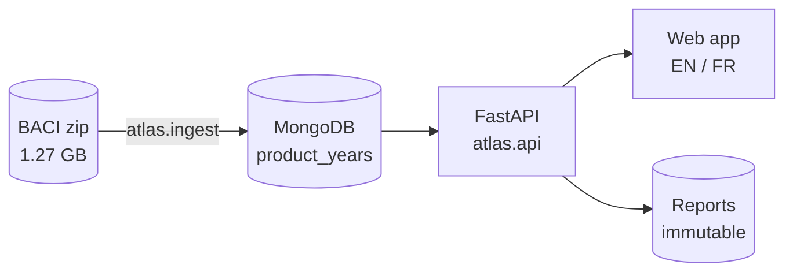

# AtlasOfDoubt

[](https://github.com/ReguiguiMohamed/AtlasOfDoubt/actions/workflows/ci.yml)

AtlasOfDoubt measures how few countries supply each product Tunisia imports, and how much a disruption at one of them would cost, from 13 years of CEPII BACI trade flows.


Tunisia imported $25.73B of goods in 2024. The 1,823 products worth at least $1M each made up $25.03B of it, and for 1,090 of them one supplier or a handful held most of the market, with a Herfindahl-Hirschman index (HHI) of 0.25 or more. Wheat is one: $653.7M from 17 countries, 45.4% of it from Russia and 79.0% from the top three.

A concentrated supplier list is a choice when the world market is open and a constraint when it is not. AtlasOfDoubt sets Tunisia's HHI for each product against the HHI of world exports of the same product. In 2024, 877 products worth $12.42B were concentrated in Tunisia while the world market was open, so other suppliers existed.

## How it works

1. **Import.** `python -m atlas.ingest` streams the 13 yearly files of a BACI release, keeps the 717,531 flows into Tunisia, and stores one document per product and year with its suppliers embedded and its measures computed.
2. **Snapshot.** Every release lands under its own id, `BACI_HS12_V202601`, so a later release never changes numbers a report already cites.
3. **Measure.** One module, `atlas/metrics.py`, computes totals, top share, top-3 share and HHI. The import, the API and saved reports all call it.
4. **Explore.** A FastAPI server serves the API and a web app with an overview, product and supplier-country pages, the "Choice or structure?" quadrant, the biggest shifts in concentration since 2012 and a map of modelled sea routes with the value behind each strait. In 2024, $5.3B of the $25.7B Tunisia imported came from countries whose usual lane runs through Suez.
5. **Stress test.** A scenario cuts a share r of what chosen suppliers send, `affected = r × Σ supplier value`, and saves the result as an immutable report with its source hash, a CSV export and a print layout.



## Run it

Both paths need the BACI archive in `data/raw/`:

```bash
curl -L --create-dirs -o data/raw/BACI_HS12_V202601.zip https://www.cepii.fr/DATA_DOWNLOAD/baci/data/BACI_HS12_V202601.zip
```

**With Docker**, nothing else to install:

```bash
docker compose up --build -d
```

```bash
docker compose run --rm app python -m atlas.ingest data/raw/BACI_HS12_V202601.zip
```

Then open http://localhost:8000. The import runs once and the data stays in the `mongo` volume.

**Without Docker**, with Python 3.12 and MongoDB on port 27017:

```bash
pip install -e ".[dev]"
```

```bash
python -m atlas.ingest data/raw/BACI_HS12_V202601.zip
```

```bash
uvicorn atlas.api:app
```

`pytest -q` runs the tests against the same local MongoDB in a database of its own, `atlas_test`.

## Results

| Check | Result |
| --- | --- |
| Tests | 49 passed, CI run [38955478004](https://github.com/ReguiguiMohamed/AtlasOfDoubt/actions/runs/38955478004) in 38 s |
| Full import in Docker | 17 min 32 s for 142,112,452 flows, 0 rows rejected |
| Stored | 60,188 product-years, 5,084 products, 200 supplier countries |
| 2024, products over $1M | 1,823, of which 1,090 with HHI at or above 0.25 |
| Concentrated by choice, 2024 | 877 products, $12.42B of $25.03B |
| Wheat 1001, 2024 | $653.7M, 17 suppliers, Russia 45.4%, top 3 79.0%, HHI 0.283 |
| API, median of 5 | overview 801 ms, product history 60 ms, movers 425 ms, country profile 278 ms |

## Repository

| Path | Contents |
| --- | --- |
| [`atlas/`](atlas/) | import, metrics, API and the web app, with what each test guarantees |
| [`tests/`](tests/) | unit, import and API tests against a real MongoDB |
| [`docs/`](docs/) | conception diagrams, data dictionary and three case studies |
| [`docker-compose.yml`](docker-compose.yml) | MongoDB 9.0 and the app, both pinned |

## Built with

Python 3.12, FastAPI 0.143.3, PyMongo 4.19.0, MongoDB 9.0, ECharts 5.6.0, Tabulator 6.3.1, topojson-client 3.1.0 and world-atlas 2.0.2.

## Data

[CEPII BACI](https://www.cepii.fr/CEPII/en/bdd_modele/bdd_modele_item.asp?id=37), HS 2012 nomenclature, release V202601, under the Etalab Open License 2.0. Only flows into Tunisia are stored, plus the concentration and top exporters of each product's world market. The archive stays out of git and out of the image.

## License

[MIT](LICENSE). Built by [Mohamed Reguigui](https://github.com/ReguiguiMohamed) and [Firas Taktak](https://github.com/FirasTaktak).
