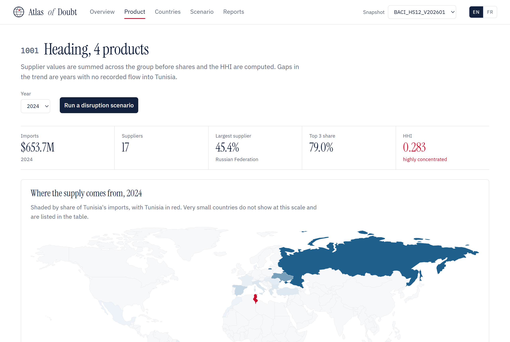
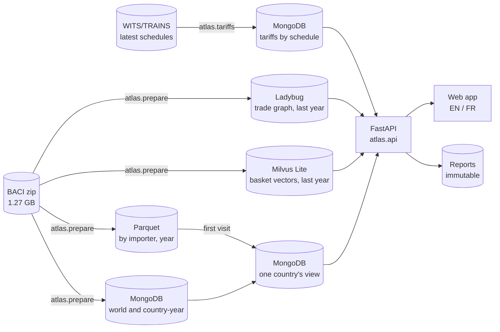

# AtlasOfDoubt

[](https://github.com/ReguiguiMohamed/AtlasOfDoubt/actions/workflows/ci.yml)

AtlasOfDoubt measures, for any country, how few suppliers sell it each product it imports, where its exports go and how a disruption at one supplier would hit it, from 13 years of CEPII BACI trade flows.



Pick a country and every page reads its trade. Tunisia, the first country studied, imported $25.73B of goods in 2024. The 1,823 products worth at least $1M each made up $25.03B of it, and for 1,090 of them one supplier or a handful held most of the market, with a Herfindahl-Hirschman index (HHI) of 0.25 or more. Wheat is one: $653.7M from 17 countries, 45.4% of it from Russia and 79.0% from the top three.

A concentrated supplier list is a choice when the world market is open and a constraint when it is not. AtlasOfDoubt sets the reporter's HHI for each product against the HHI of world exports of the same product, with the reporter itself left out of the world side. On the export side it shows destinations, product and destination concentration, revealed comparative advantage, unit values with quality flags and EXPY, the income level of the basket.

## How it works

1. **Prepare.** `python -m atlas.prepare` checks the 13 yearly files of a BACI release in DuckDB, writes the valid flows once as Parquet partitioned by importer and year, and stores world totals, country-year summaries, RCA inputs and PRODY in MongoDB. An optional World Bank GDP file adds PRODY and EXPY, and the CEPII GeoDist files add the distance, a shared border and a common official language for each country pair. Each country's latest WITS/TRAINS MFN tariff schedule, mapped to HS2012, goes into MongoDB beside them, with the HS section, chapter and heading name of every product. The last year's flows also go into a Ladybug graph, one edge per exporter, importer and HS4 heading, and into Milvus Lite as one sparse vector per country and flow over its HS6 basket.
2. **Snapshot.** The snapshot id hashes every input, so preparing the same files twice returns the same snapshot, and a new release, GDP, GeoDist or tariff file lands beside the old one without changing numbers a report already cites.
3. **Materialize.** The first visit to a country builds its view from its own Parquet partition into MongoDB, as one generation that becomes readable only when complete. The least recently used countries are evicted past a 1 GB budget and rebuilt with the same figures. A restart rebuilds the 3 countries visited last.
4. **Measure.** One module, `atlas/metrics.py`, computes totals, shares, HHI, RCA, PRODY, EXPY and the scenario. Preparation, the API and saved reports all call it.
5. **Explore and stress test.** The web app shows imports, exports, products, partner countries, the tariff each market charges the chosen country on a product, preferences included, the supplier network of a heading, each country's trade twins and modelled sea routes to the chosen country. A scenario cuts a share r of what chosen suppliers send, `affected = r × Σ supplier value`, and saves the result as an immutable report.



## Run it

Both paths need the BACI archive in `data/raw/`. Prepare fetches the World Bank GDP file, the two CEPII GeoDist files and the two HS name files on its first run and keeps them in `data/snapshots/`:

```bash
curl -L --create-dirs -o data/raw/BACI_HS12_V202601.zip https://www.cepii.fr/DATA_DOWNLOAD/baci/data/BACI_HS12_V202601.zip
```

**With Docker**, nothing else to install:

```bash
docker compose up --build -d
```

```bash
docker compose run --rm app python -m atlas.prepare data/raw/BACI_HS12_V202601.zip
```

Then open http://localhost:8000. The Parquet files stay in `data/snapshots/` and the rest in the `mongo` volume.

**Without Docker**, with Python 3.12 and MongoDB on port 27017:

```bash
pip install -e ".[dev]"
```

Tariffs are optional. These two fetch the WITS schedule list, the latest schedule of every BACI country and the preferential rates of each partner it lists, about 1,500 files, into `data/snapshots/`, and prepare picks them up:

```bash
python -m atlas.coverage data/raw/BACI_HS12_V202601.zip
```

```bash
python -m atlas.tariffs
```

```bash
python -m atlas.prepare data/raw/BACI_HS12_V202601.zip
```

```bash
uvicorn atlas.api:app
```

A new release takes the same one command with its own archive. `pytest -q` runs the tests against the same local MongoDB in a database of its own, `atlas_test`.

## Results

| Check | Result |
| --- | --- |
| Tests | 92 passed locally against MongoDB 9.0, and 7 Node frontend tests |
| Tariffs, latest WITS schedules | 883,010 HS2012 rows from 170 schedules, covering 196 of BACI's countries |
| Full release in the stores | 142,112,452 flows for 238 countries, 2012 to 2024: 1,049 MB of Parquet, 408 MB of MongoDB data with 96 MB of indexes, an 89 MB Ladybug graph of 4,555,246 edges, 11 MB of Milvus vectors |
| First visit to a country, 18 October 2026 | 40 s for Fiji, 56 s for Brazil, 97 s for the USA, down from 70 s, 109 s and 166 s |
| Warm requests, median and 95th percentile | product history 40/152 ms, tariffs 45/57 ms, Milvus twins 256/341 ms, overview 413/790 ms, exports 796/917 ms, Ladybug network 1.1/1.2 s, country profile 1.0/2.2 s, routes 1.4/3.1 s |
| Tunisia, 2024, products over $1M | 1,823, of which 1,090 with HHI at or above 0.25 |
| Tunisia, concentrated by choice, 2024 | 877 products, $12.42B of $25.03B |
| Tunisia, wheat 1001, 2024 | $653.7M, 17 suppliers, Russia 45.4%, top 3 79.0%, HHI 0.283 |

Timings ran on one Windows laptop against snapshot `BACI_HS12_V202601@537b2fe453e3`, 5 warm gzip requests per endpoint for each of the USA, Brazil, Kenya and Fiji. First visits gained most from packing Decimal128 values with integer arithmetic, since pymongo converts each of a country's 2.6 million decimals bit by bit in Python. The exports page used to send each product with its own destinations, 3.0 MB gzipped in 7.5 s for the USA. It now sends the products without them, 0.6 MB in 0.9 s, and the product page reads one product's destinations when it is opened. Routes and the country profile now make up the slow tail. The Tunisia figures come from the earlier Tunisia-only import, measured on the same release with the same `metrics.py`. Storage and build-time estimates for every country are in [architecture-research.md](docs/architecture-research.md).

## Repository

| Path | Contents |
| --- | --- |
| [`atlas/`](atlas/) | preparation, country views, metrics, API and the web app, with what each test guarantees |
| [`tests/`](tests/) | unit, preparation and API tests against a real MongoDB |
| [`docs/`](docs/) | conception diagrams, data dictionary, storage research and three case studies |
| [`docker-compose.yml`](docker-compose.yml) | MongoDB 9.0 and the app, both pinned |

## Built with

Python 3.12, FastAPI 0.143.3, PyMongo 4.19.0, DuckDB 1.5.6, MongoDB 9.0, Ladybug 0.21.2, Milvus Lite 3.2.2 with PyMilvus 3.0.2, ECharts 5.6.0, Tabulator 6.3.1, topojson-client 3.1.0 and world-atlas 2.0.2.

## Data

[CEPII BACI](https://www.cepii.fr/CEPII/en/bdd_modele/bdd_modele_item.asp?id=37), HS 2012 nomenclature, release V202601, under the Etalab Open License 2.0. GDP per capita, PPP, constant 2021 dollars, from the [World Bank WDI](https://data.worldbank.org/indicator/NY.GDP.PCAP.PP.KD) under CC BY 4.0. Distances, borders, languages and landlocked status from [CEPII GeoDist](https://www.cepii.fr/CEPII/en/bdd_modele/bdd_modele_item.asp?id=6) under the Etalab Open License 2.0, with the distance taken between the most populated cities (Mayer and Zignago, 2011). Import tariffs from UNCTAD TRAINS, retrieved through the World Bank's [WITS](https://wits.worldbank.org), under the WITS/TRAINS licence in the World Bank data catalogue. TRAINS data are provided as is, and the user assumes all risk in their use. HS section, chapter and heading names, in English only, from the [DataHub harmonized-system](https://github.com/datasets/harmonized-system) dataset under the ODC Public Domain Dedication and License 1.0. The archive, the tariff files and the prepared files stay out of git and out of the image.

## License

[MIT](LICENSE). Built by [Mohamed Reguigui](https://github.com/ReguiguiMohamed) and [Firas Taktak](https://github.com/FirasTaktak).
