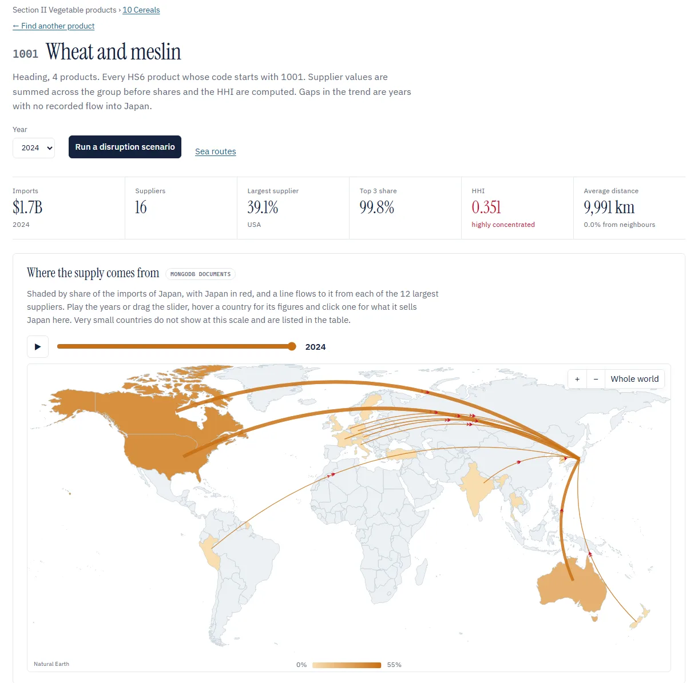
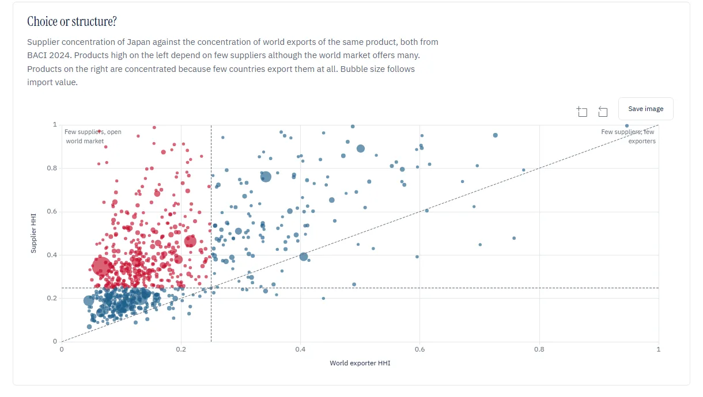
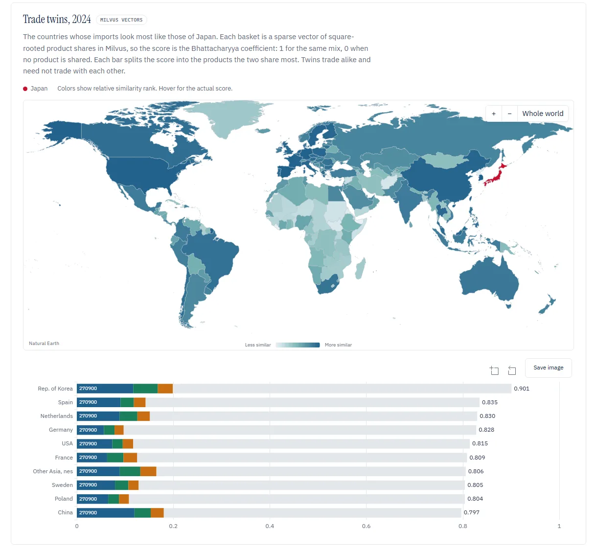
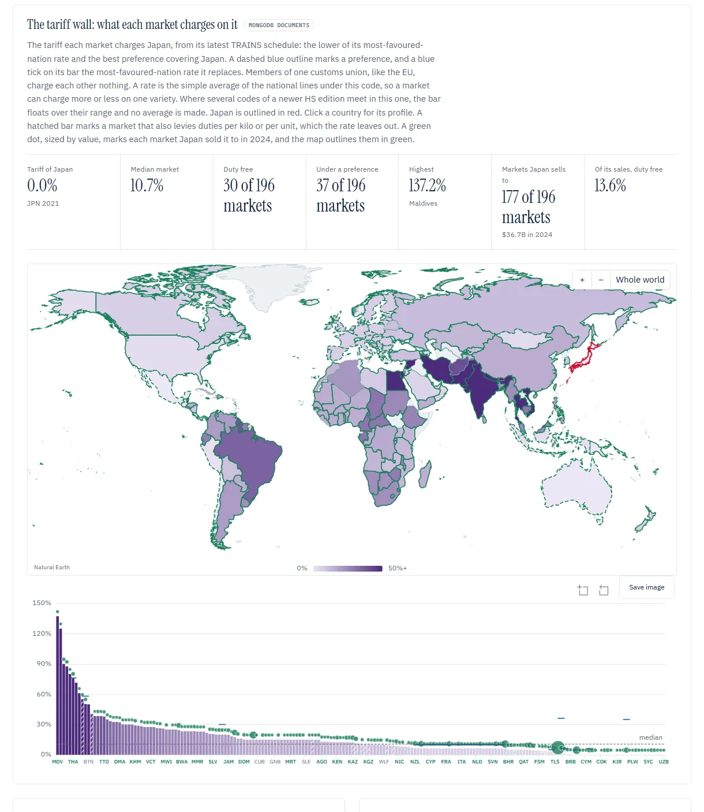
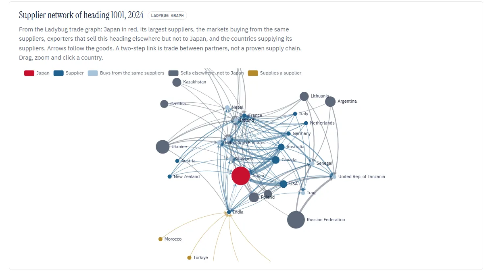
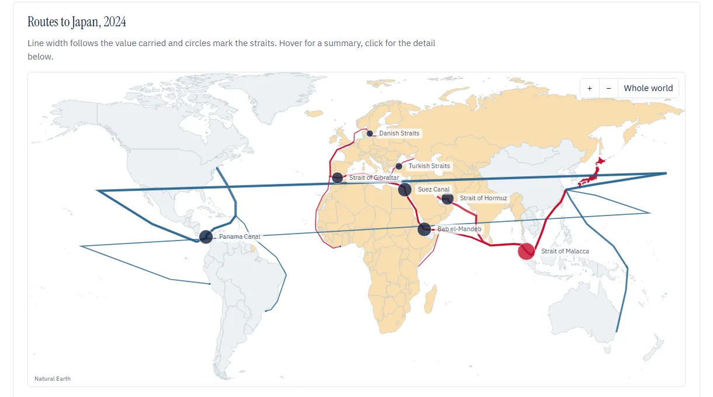
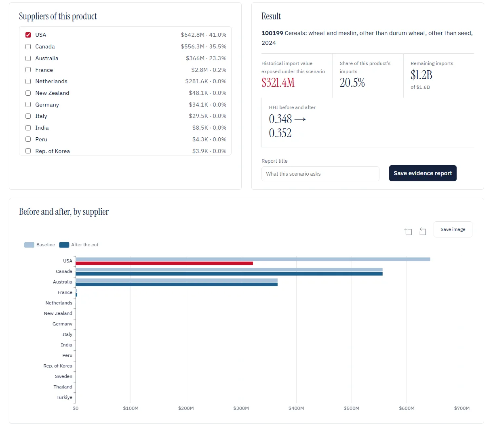
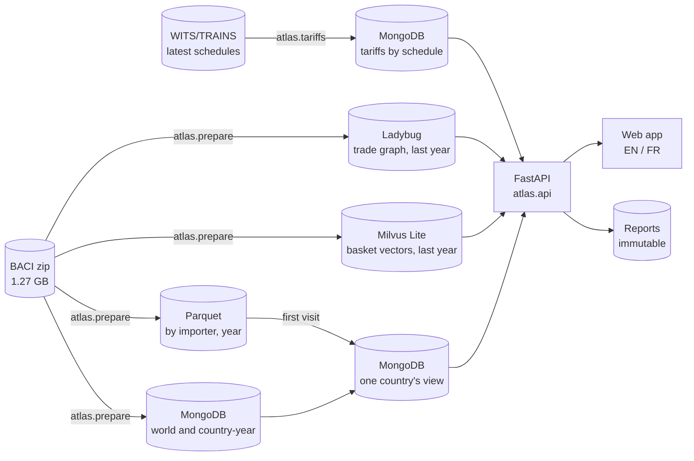

# AtlasOfDoubt

[](https://github.com/ReguiguiMohamed/AtlasOfDoubt/actions/workflows/ci.yml)

AtlasOfDoubt shows, for any of 238 countries, how few suppliers sell it each product it imports, where its exports go and what a cut at one supplier would cost, from 13 years of CEPII BACI trade flows.

Live at [atlasofdoubt.francecentral.cloudapp.azure.com](https://atlasofdoubt.francecentral.cloudapp.azure.com), one Azure VM described in [`deploy/`](deploy/).
A static sample of eight countries in 2024 stays online at [reguiguimohamed.github.io/AtlasOfDoubt](https://reguiguimohamed.github.io/AtlasOfDoubt/).

[](https://atlasofdoubt.francecentral.cloudapp.azure.com)

Pick a country and every page reads its trade. Japan bought $1.7B of wheat in 2024 from 16 countries, but the top three sent 99.8% of it.

A short supplier list is a choice when the world market is open and a constraint when few countries export at all. AtlasOfDoubt sets each product's supplier HHI against the HHI of world exports of the same product, with the reporter left out of the world side.

## What it shows

| | |
| --- | --- |
|  |  |
| **Choice or structure.** Supplier HHI against world exporter HHI, one bubble per product. [Imports](atlas/static/README.md#imports) | **Trade twins.** Countries whose import basket looks most like the reporter's, from Milvus vectors. [Twins](atlas/README.md#stores) |
|  |  |
| **Tariff wall.** The rate every market charges the reporter on one product, preferences included. [Product](atlas/static/README.md#product) | **Supplier network.** Who else buys from the same suppliers, from the Ladybug graph. [Product](atlas/static/README.md#product) |
|  |  |
| **Sea routes.** Import value per modelled lane and chokepoint. [Routes](atlas/README.md#sea-routes) | **Scenario.** Cut a share of chosen suppliers and save the result as a report. [Scenario](atlas/static/README.md#scenario-and-reports) |

## How it works



1. **Prepare.** DuckDB checks the 13 yearly files and writes them once as Parquet by importer and year.
2. **Snapshot.** The id hashes every input, so a new release lands beside the old one.
3. **Materialize.** A country's first visit builds its view into MongoDB, first and last years first.
4. **Measure.** One module, [`metrics.py`](atlas/metrics.py), does every sum, share and HHI.
5. **Explore.** The web app reads the views, the graph, the twins and the tariffs.

Each step is detailed in [`atlas/`](atlas/README.md).

## Run it

```bash
curl -L --create-dirs -o data/raw/BACI_HS12_V202601.zip https://www.cepii.fr/DATA_DOWNLOAD/baci/data/BACI_HS12_V202601.zip
```

```bash
docker compose up --build -d
```

```bash
docker compose run --rm app python -m atlas.prepare data/raw/BACI_HS12_V202601.zip
```

Then open http://localhost:8000. Running without Docker and adding tariffs are in [`atlas/`](atlas/README.md#run-without-docker).

## Results

| Check | Result |
| --- | --- |
| Tests | 116 pytest tests against MongoDB 9.0 and 10 Node tests, see [`tests/`](tests/) |
| Full release | 142,112,452 flows, 238 countries, 2012 to 2024 |
| Stores | 1,049 MB Parquet, 408 MB MongoDB data with 96 MB of indexes, 89 MB Ladybug graph of 4,555,246 edges, 11 MB Milvus vectors |
| Tariffs | 883,010 HS2012 rows from 170 WITS schedules, covering 196 countries |
| First visit, every year | Fiji 40 s, Brazil 56 s, USA 97 s |
| First visit, imports page | Japan 11 s, Germany 36 s |
| Warm request, median | product history 40 ms, tariffs 45 ms, twins 256 ms, overview 413 ms, exports 796 ms, network 1.1 s, routes 1.4 s |
| Japan, wheat 1001, 2024 | $1.7B, 16 suppliers, USA 39.1%, top 3 99.8%, HHI 0.351 |

Timings ran on one Windows laptop on 18 October 2026, snapshot `BACI_HS12_V202601@537b2fe453e3`, 5 warm gzip requests per endpoint for the USA, Brazil, Kenya and Fiji. Storage estimates are in [architecture-research.md](docs/architecture-research.md).

## Repository

| Path | Contents |
| --- | --- |
| [`atlas/`](atlas/) | preparation, stores, country views, metrics and the API |
| [`atlas/static/`](atlas/static/) | the web app, page by page |
| [`tests/`](tests/) | what each test guarantees |
| [`docs/`](docs/) | conception diagrams, data dictionary, storage research and case studies |
| [`docker-compose.yml`](docker-compose.yml) | MongoDB 9.0 and the app, both pinned |
| [`deploy/`](deploy/) | the public Azure server, Caddy for HTTPS and the data copy |

## Built with

Python 3.12, FastAPI 0.143.3, PyMongo 4.19.0, DuckDB 1.5.6, MongoDB 9.0, Ladybug 0.21.2, Milvus Lite 3.2.2 with PyMilvus 3.0.2, ECharts 5.6.0, Tabulator 6.3.1, topojson-client 3.1.0 and world-atlas 2.0.2.

## Data

| Source | Used for | Licence |
| --- | --- | --- |
| [CEPII BACI](https://www.cepii.fr/CEPII/en/bdd_modele/bdd_modele_item.asp?id=37) HS12 V202601 | trade flows | Etalab Open License 2.0 |
| [World Bank WDI](https://data.worldbank.org/indicator/NY.GDP.PCAP.PP.KD) | GDP per capita, PPP, constant 2021 dollars | CC BY 4.0 |
| [CEPII GeoDist](https://www.cepii.fr/CEPII/en/bdd_modele/bdd_modele_item.asp?id=6) | distance between the most populated cities, borders, languages (Mayer and Zignago, 2011) | Etalab Open License 2.0 |
| UNCTAD TRAINS through [WITS](https://wits.worldbank.org) | MFN and preferential tariffs, provided as is, the user assumes all risk | WITS/TRAINS licence |
| [DataHub harmonized-system](https://github.com/datasets/harmonized-system) | HS section, chapter and heading names, English only | ODC PDDL 1.0 |

The archive, the tariff files and the prepared files stay out of git and out of the image.

## License

[MIT](LICENSE). Built by [Mohamed Reguigui](https://github.com/ReguiguiMohamed) and [Firas Taktak](https://github.com/FirasTaktak).
