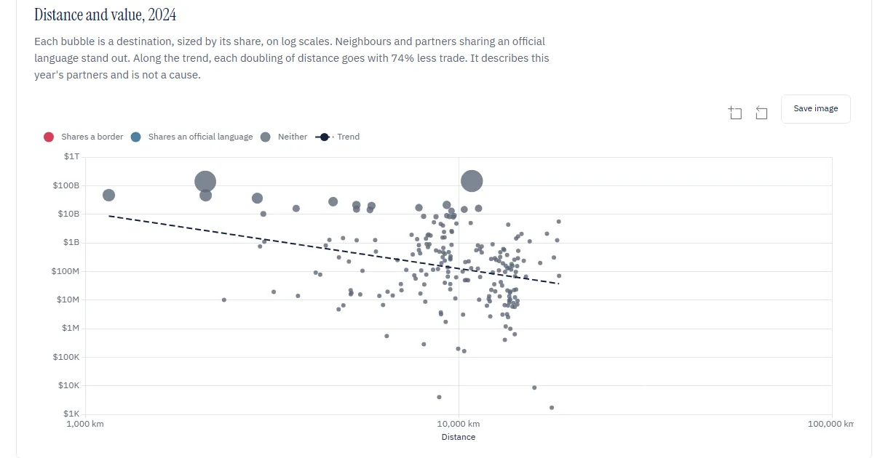

# static

The web app. Plain ES modules with a hash router, ECharts 5.6.0 and Tabulator 6.3.1 from jsDelivr with SRI hashes, in English and French.

| File | Does |
| --- | --- |
| [`app.js`](app.js) | header, router, country choice and preload |
| [`lib.js`](lib.js) | API client with its cache, charts, maps and pickers |
| [`i18n.js`](i18n.js) | English and French strings |
| [`views/`](views/) | one module per page |

## Imports

`#/overview?year&minValue`

- Every product imported in a year with its supplier HHI.
- A donut and ranked list that drill from HS sections to products.
- The choice or structure quadrant of supplier HHI against world exporter HHI.
- The products whose HHI rose or fell most since an earlier year.
- Import twins on a map and in bars split by the products they share.

## Exports

`#/exports?year&minValue`

- Exports and imports from 2012 to 2024, product and destination HHI, EXPY.
- Destinations with distance, border and language, and a bubble chart against distance.
- Each product with its world share, RCA, unit value and quality flags.
- Export twins on a map and in bars.
- Products arrive without their destinations, 0.6 MB gzipped for the USA, and a product's destinations load when it is opened.

## Product

`#/product/{code}?year` for a product, heading or chapter.

- A world map of suppliers with animated flows and a year slider from 2012 to 2024.
- Supplier bars, distance, border and language, and value against distance.
- Imports, exports, RCA, HHI and supplier shares over time.
- The 25 largest world exporters against what each sent the reporter.
- The tariff wall: every market's rate on a map and a sorted wall, with preferences, ranges and non-ad-valorem duties marked.
- The supplier network from the Ladybug graph.

## Partners

`#/country` and `#/country/{code}?year`

- Every partner country with a search box.
- One partner: distance, border, language, landlocked status and its sea route.
- What it supplied and bought back each year, and its rank among each product's suppliers.

## Sea routes

`#/routes?year&code&select`

- Supplier value per route and per chokepoint on a map, for all products or one code.
- A detail panel with the trend, the countries, the products most exposed and a link to simulate a closure.

## Scenario and reports

`#/scenario?mode&code&year&suppliers&reduction` and `#/reports/{id}`

- Cut a share r of what the chosen suppliers send, `affected = r × Σ supplier value`, by product or by supplier country.
- The preview is live, and saving recomputes it on the server, ignoring browser numbers.
- A report keeps the snapshot id, archive SHA-256, calculation version and limitations, with CSV download and a print layout.

## Behaviour

- The reporter sits in `?reporter=`, so a shared link opens on the same country.
- A snapshot's answers never change, so the browser keeps the last 40 in memory and preloads imports, exports, routes and twins. On Japan the next click sent no request and drew in 0.6 to 0.9 s.
- Maps zoom with the wheel, a pinch or the + and − buttons, and Whole world resets them. Boundaries are Natural Earth 1:50m from world-atlas 2.0.2.
- Charts zoom with Ctrl and the wheel or a drawn box, and reset on a double-click. Save image downloads a PNG.
- Each view renders into a fresh section, so a slow request from a page already left never writes into the current one.
- On phones, Menu opens every page.
