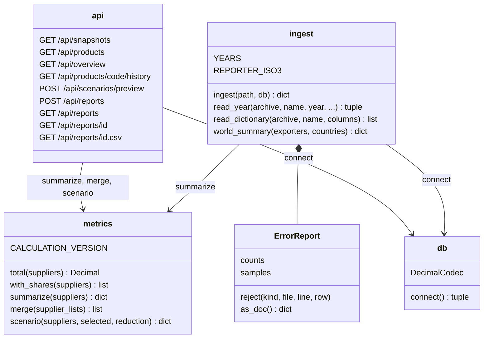
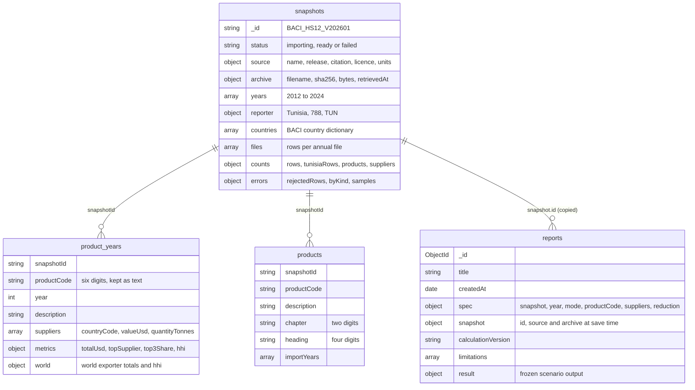
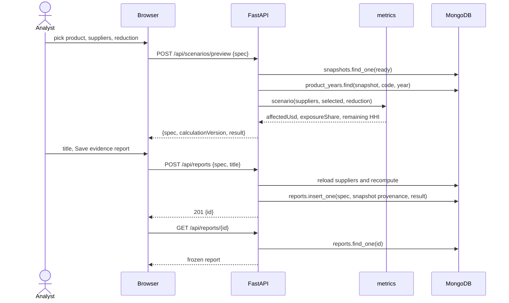
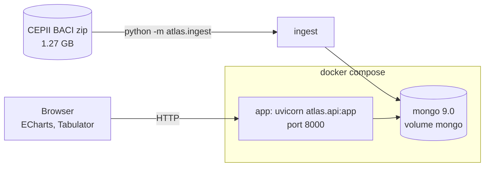

# Conception

Four diagrams of how AtlasOfDoubt is built. The field-level detail lives in
the [data dictionary](data-dictionary.md).

## Classes

The Python side is four modules. Every number the API returns or a report
stores goes through `metrics`, so a live preview and a saved report cannot
disagree.

## MongoDB documents

One snapshot per imported BACI release. Its product years and products carry
the snapshot id, so two releases sit side by side and a report keeps
pointing at the one it was computed from.

Indexes:

| Collection | Index | Why |
| --- | --- | --- |
| `product_years` | `snapshotId, productCode, year` unique | one document per flow cell, and prefix search on a chapter or heading |
| `product_years` | `snapshotId, year` | the overview and country scenarios read a whole year |
| `products` | `snapshotId, productCode` unique | product search and group lookup |
| `reports` | `createdAt` descending | newest reports first |

## Saving a report

The browser sends only the scenario specification. The server reloads the
supplier values and recomputes, so a number typed or tampered with in the
browser never reaches a report.

## Deployment

The archive is mounted read-only at `/data/raw` inside the app container
and never enters git or the image.
