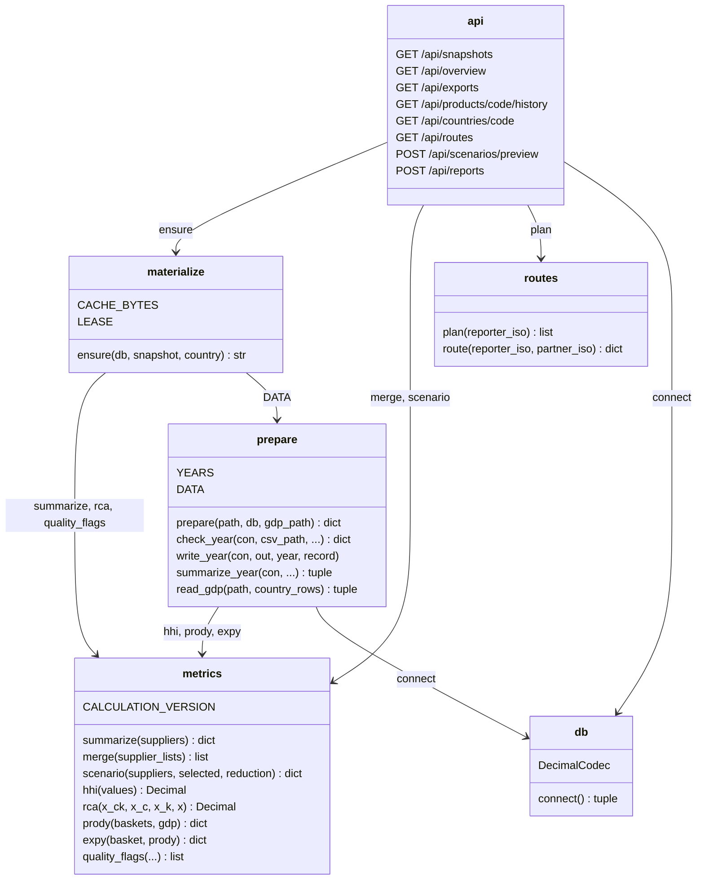
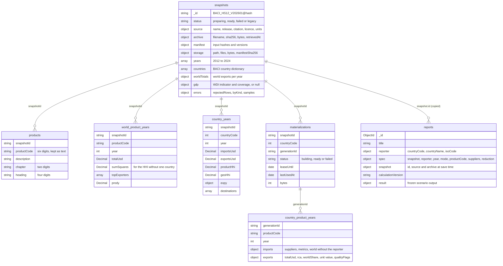
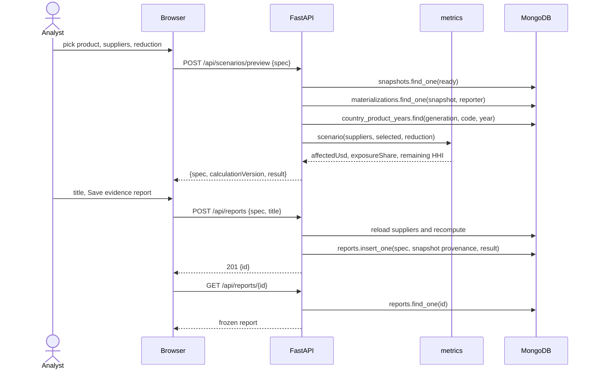
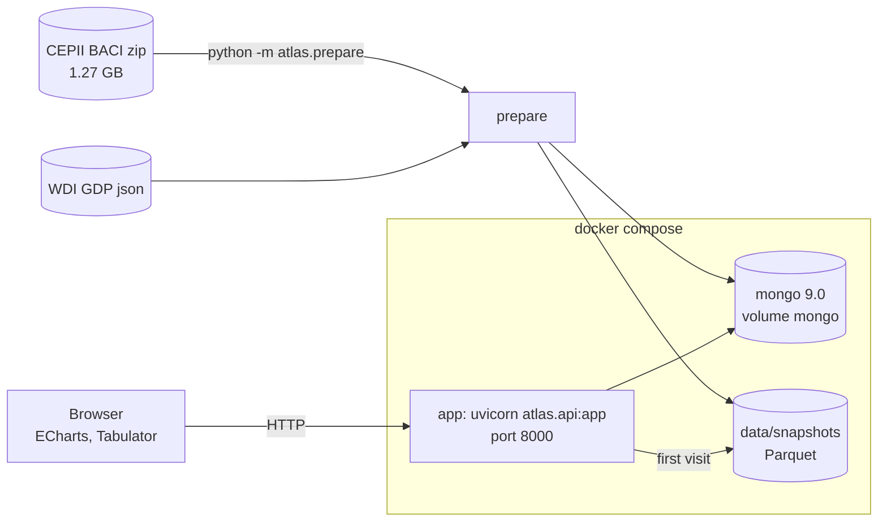

# Conception

Four diagrams of how AtlasOfDoubt is built. The field-level detail lives in
the [data dictionary](data-dictionary.md).

## Classes

The Python side is six modules. Every number the API returns or a report
stores goes through `metrics`, so a live preview and a saved report cannot
disagree.

## Stored data

A snapshot is one prepared release. Its flows live as Parquet under
`data/snapshots/{id}/`, partitioned by importer and year, beside a manifest
with every file's rows and SHA-256. MongoDB holds the snapshot record, the
world and country-year aggregates, and one generation of documents per
country that has been visited.

Indexes:

| Collection | Index | Why |
| --- | --- | --- |
| `products` | `snapshotId, productCode` unique | product search and group lookup |
| `world_product_years` | `snapshotId, productCode, year` unique | the world side of a country build |
| `country_years` | `snapshotId, countryCode, year` unique | the export trend of one reporter |
| `materializations` | `snapshotId, countryCode` unique | one build job per country, claimed atomically |
| `country_product_years` | `generationId, productCode, year` unique | one document per cell, and prefix search on a chapter or heading |
| `country_product_years` | `generationId, year, imports.metrics.totalUsd` and `exports.totalUsd` | the overview and the exports page read a whole year, largest first |
| `country_product_years` | `generationId, imports.suppliers.countryCode, year` | a partner country's profile |
| `reports` | `reporter.countryCode, createdAt` descending | a reporter's newest reports first |

## Saving a report

The browser sends only the scenario specification. The server reloads the
supplier values and recomputes, so a number typed or tampered with in the
browser never reaches a report.

## Deployment

The archive is mounted read-only at `/app/data/raw` and the prepared
snapshots at `/app/data/snapshots`. Neither enters git or the image.
